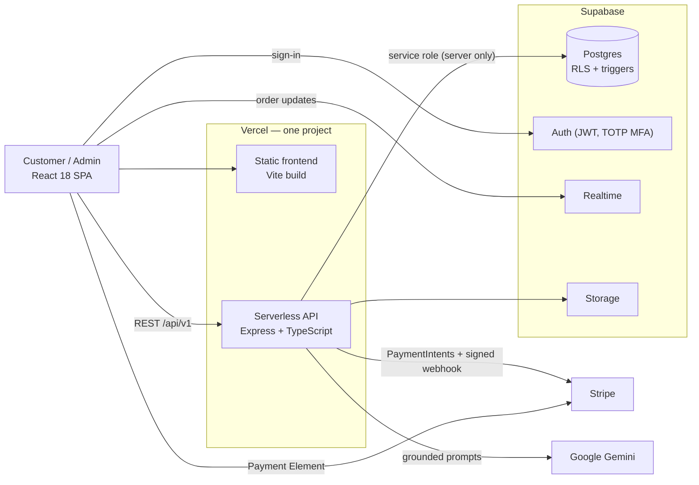
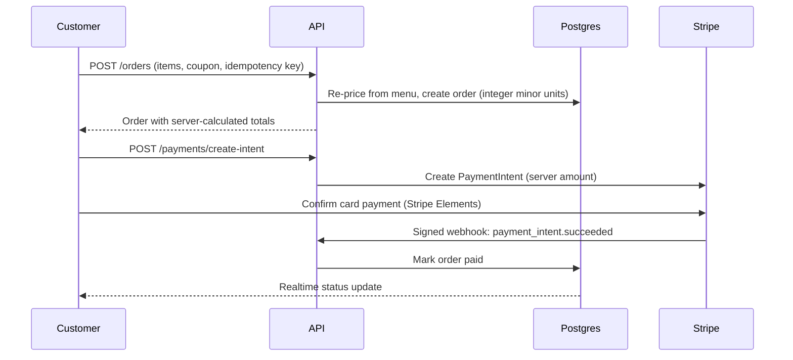
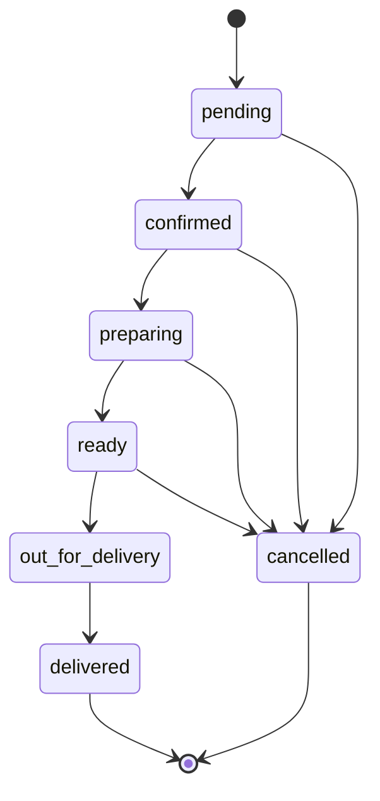

<div align="center">

<picture>
  <source media="(prefers-color-scheme: dark)" srcset="public/ember-co-logo.svg">
  
</picture>

# Ember & Co.

### Online orders, table reservations and restaurant management — in one website you own.

Guests browse your menu, order, book a table and pay online. Your team runs everything from one secure admin panel.

[**🔗 Live demo**](https://embercoui.vercel.app) · [What you get](#-what-your-restaurant-gets) · [Try the demo](#-try-the-live-demo) · [Features](#-features) · [Under the hood](#-under-the-hood) · [Contact](#-lets-work-together)

<br>


[](LICENSE)

</div>

---

## 🍴 What your restaurant gets

| | |
|---|---|
| 🛒 **Online orders** | Guests build a cart on your website and place an order in a few taps. They pay by card or cash on delivery, then **follow their order live** — Placed → Preparing → On its way → Delivered. |
| 📅 **Table reservations** | Guests book online and the system **stops a time slot from being overbooked**. You can add phone and walk-in bookings in seconds, and optionally charge a booking fee by card. Guests can request changes to their own booking. |
| 💳 **Secure payments** | Card payments run through **Stripe** — card details go straight to Stripe and are never stored on your site. An order is marked *paid* only after Stripe confirms the payment. |
| 🧑‍🍳 **One place to run the business** | Update dishes, photos and prices. Open or close the kitchen and set wait times. Manage opening hours, coupons, reviews, your newsletter list and sales reports — all from one admin panel. |
| 👥 **You control who can do what** | Owner, manager and staff accounts, each limited to the sections you choose. Two-factor sign-in, a log of who changed what, and a **screen lock** for shared counter tablets that hides customer details. |
| 🤖 **A helpful assistant, any time of day** | Ember AI answers questions about your menu, hours and table availability, adds dishes to the guest's cart, and can **book a table right inside the chat**. |
| 🌍 **Ready for your market** | Works in any currency, includes a WhatsApp chat button, looks great on phones, and runs on your own domain. |
| 🔎 **Easier to find online** | Pages and files for search engines and AI search tools are generated automatically from your live menu and settings, so they never go out of date. |

**Your site, your data.** Each restaurant gets its own deployment — its own domain, its own database and its own branding. It is not a shared marketplace. To launch a new restaurant, you change the name, contact details, hours, currency and menu in the admin panel and point the site at your domain. No code changes needed.

---

## 🎮 Try the live demo

**[embercoui.vercel.app](https://embercoui.vercel.app)** — works on desktop and mobile, no sign-up needed.

1. **Browse the menu** at `/menu` — use the search box and the *Vegan / Spicy / Gluten Free* filters.
2. **Add dishes to the cart** and go to checkout. Choose **cash on delivery** to place an order without paying anything.
3. **Watch the live order tracker** you land on after ordering — it updates in real time.
4. **Book a table** from the *Reservations* section on the homepage.
5. **Ask Ember** — tap the chat button in the corner and try *"What's vegan on the menu?"*, *"Add two of those to my cart"* or *"Do you have a table for four tomorrow?"*
6. **Create an account** (email or Google) to see order history, favourites and saved addresses.

**Admin panel:** `/admin` is where the owner manages everything. Demo access is available on request — [email me](mailto:heyhamza.dev@gmail.com) and I'll set up a limited demo account.

> 🧪 **This is a sandbox for evaluation.** Please don't enter real personal or payment details.

<!--
OWNER NOTE — delete this block before publishing.

Admin demo options (pick one):
 A) Keep "on request" (safest).
 B) Publish a dedicated, least-privilege demo account here — never your owner account:
      Email:    <demo account email>
      Password: <demo password>
    Create it on a separate demo Supabase project that holds seed data only, give it view-only
    permissions on the sections you want to show, and set MFA to "not required" for that account.
 C) Replace the login with a short screen recording of the admin flow.

Never put service-role keys, Stripe secret keys or real customer data in the demo.
-->

<!--
📸 SCREENSHOTS — add images to docs/screenshots/ and uncomment this block.

| Home | Menu | Checkout |
|---|---|---|
|  |  |  |

| Admin dashboard | Reservations board | Locked screen (customer data hidden) |
|---|---|---|
|  |  |  |
-->

---

## ✨ Features

### Customer experience

- **Cinematic homepage** — hero video on desktop with an optimised mobile image and a graceful fallback, gallery, testimonials, newsletter signup, and a **live kitchen status** badge (open or closed, with the current wait-time range).
- **Menu** — served live from the API, with categories built from the data itself, search, and **Vegan / Spicy / Gluten-Free filters driven only by kitchen-assigned tags** (never guessed from dish descriptions).
- **Cart** — persists across visits; stored data is validated on load, so corrupt entries are dropped and duplicates merged without losing items.
- **Accounts** — email/password and **Google sign-in**, password reset, and an account area with **Orders · Reservations · Favorites · Addresses · Profile · Leave a Review**.
- **Checkout** — totals recalculated on the server, coupon codes (percent or fixed), **cash on delivery or card via Stripe**, and an idempotency key so retries and double-clicks never create duplicate orders.
- **Live order tracking** — status timeline updated in real time through **Supabase Realtime, with an automatic 15-second polling fallback**. Guests can track an order by its unguessable ID.
- **Reservations** — real calendar validation, a 20-guest online cap and **per-time-slot capacity enforced on the server**. Optional booking fee by card. Signed-in guests can request changes from their account.
- **Contact & location** — contact form, per-location contact details, opening hours, a map, and a floating **WhatsApp button that appears only when the restaurant sets a number**.
- **Multi-currency** — any ISO 4217 currency with correct minor-unit handling (0-, 2- and 3-decimal currencies). Orders keep the currency they were placed in, so history stays correct if the restaurant switches later.
- **Fast by design** — route-level code splitting; every admin screen and heavy page is lazy-loaded.

### Ember AI assistant (Google Gemini)

A chat assistant **grounded in live data**, not a generic chatbot:

- Answers from the real menu, settings, opening hours and **today/tomorrow seat availability**.
- **Adds dishes to the cart** on request — checkout always stays manual and in the guest's hands.
- **Books tables inside the chat** — mentions any booking fee up front, collects it by card when required, and says so plainly when a slot is full.
- Reports on the **signed-in guest's recent orders** and on what's in their cart. The server resolves menu IDs to names and prices, so clients can never feed the model fake prices.
- **Resilient** — automatic fallback across Gemini models, a hard overall time budget (a slow upstream becomes an honest error, not a platform timeout), input limits and rate limiting.

### Admin panel (`/admin`)

| Section | What it does |
|---|---|
| **Dashboard** | Real revenue and order totals |
| **Orders** | Filter and manage statuses through an enforced state machine; updates the customer's tracker in real time |
| **Menu** | Full CRUD with image upload to Supabase Storage (images are compressed in the browser to fit serverless body limits) |
| **Reservations** | Day board with per-slot capacity, walk-in and phone bookings, edits, statuses, and an **inbox for customer change requests** (apply, decline or mark handled) |
| **Customers** | Customer list with spend totals |
| **Reviews** | Moderation queue — reviews are created unapproved and appear only once approved |
| **Newsletter** | Subscriber list and **CSV export** (safe against spreadsheet-formula injection) |
| **Marketing** | Coupon management (percent or fixed, expiry, active state) with merged-state validation |
| **Finance** | Paid-only revenue by day and by month |
| **Staff** | Roles, per-person permissions, editable role defaults, MFA requirements and resets |
| **Settings** | Kitchen open toggle, wait times, currency, restaurant profile, WhatsApp number, slot capacity, reservation fee, opening hours, per-location contacts with a map picker |
| **Security** | Audit-trail viewer for privileged changes and sign-in events, with CSV export |

### Access control & admin security

- **Granular roles and permissions** — customer, staff, manager and owner. Twelve admin sections, each set to `none`, `view` or `manage`. Permissions are resolved **on the server for every request** (owner → personal override → role default → built-in default), so a change applies immediately with no re-login.
- **Two-factor authentication (TOTP)** via Supabase Auth. The owner decides who must use it; role defaults apply otherwise, and the server enforces it by checking the session's assurance level.
- **Admin screen lock** — lock the panel during a shift change and only the **live orders board** stays visible, with customer data masked (phone → last 2 digits, name → first name + initial, email and address fully hidden). Unlocking needs step-up re-authentication (password or Google, plus a TOTP code when enrolled).
- **Audit trail** — every privileged change is logged with who, their role, per-field before/after values, IP and user agent. The owner is not exempt. Client-reported events such as failed logins are clearly labelled unverified.
- **Last-admin guard** — the final admin account can never be demoted.

### Search & AI-search readiness

- `robots.txt`, `sitemap.xml`, **`llms.txt` and `llms-full.txt`** are **rendered per request from live settings and menu data** — nothing hard-coded, nothing to go stale.
- Per-page titles and meta descriptions with Open Graph / Twitter tags, built from the live brand name.
- **Restaurant JSON-LD** generated from real data; fields the restaurant hasn't set are omitted, never invented.
- Honest content rules: card payment is mentioned only when enabled, and a booking fee only when a booking would genuinely be charged one.

---

## 🔧 Under the hood

*For engineers, technical reviewers and hiring managers.*

### By the numbers — verify them yourself

Every number in this README can be reproduced from the repository.

| Claim | Number | Source of truth |
|---|---|---|
| HTTP endpoints | **66** (39 under `/admin`; includes health, the Stripe webhook and the SEO files) | `backend/src/routes/*.ts`, `backend/src/app.ts` |
| Admin sections | **12** | `SECTION_KEYS` in `backend/src/lib/permissions.ts` |
| User roles | **4** (customer, staff, manager, admin) | `UserRole` in `backend/src/repositories/types.ts` |
| SQL migrations | **18** | `supabase/migrations/` |
| Test files | **77** (46 backend + 31 frontend) | `backend/tests/`, `src/**/*.test.{ts,tsx}` |
| Test cases | **1,000+** (1,003 declared, none skipped) | same as above |
| CI jobs | **3** (frontend, backend, `vercel-entry`) | `.github/workflows/ci.yml` |

```bash
# Run from the repository root
ls supabase/migrations/*.sql | wc -l                                              # 18 migrations
grep -rahE "(router|app)\.(get|post|put|patch|delete)\(" backend/src | wc -l      # 66 endpoints
grep -cE "router\.(get|post|put|patch|delete)\(" backend/src/routes/admin.ts       # 39 admin endpoints
grep -A3 "SECTION_KEYS =" backend/src/lib/permissions.ts                           # 12 admin sections
find . \( -name "*.test.ts" -o -name "*.test.tsx" \) -not -path "*/node_modules/*" | wc -l   # 77 test files
grep -rahE "^[[:space:]]*(it|test)(\.each)?\(" --include="*.test.ts" --include="*.test.tsx" \
  --exclude-dir=node_modules . | wc -l                                             # 1003 test cases
```

> The test-case figure counts declared `it(...)` / `test(...)` calls. For the runner's own pass/fail totals — which also expand parameterised tests — run `npm test` and `cd backend && npm test` after installing dependencies.

### Architecture



**Payment flow — an order is paid only when Stripe says so**



**Order lifecycle — illegal jumps are rejected server-side**



### Security & reliability engineering

| Area | What's implemented |
|---|---|
| **Money integrity** | Totals recalculated server-side in integer minor units; client-sent prices are never trusted; discounts clamped to the subtotal and percent coupons capped at 100; an order is marked paid **only** by a signature-verified Stripe webhook. |
| **Privilege escalation** | Row Level Security on every table; the service-role key never leaves the server. Authority columns (`role`, `permissions`, `mfa_required`) are protected by **database triggers**, so a customer cannot promote themselves even with a direct API call. |
| **Order privacy** | Orders are visible to their owner and authorised staff, or by an unguessable ID for guest orders; everyone else gets a 404. |
| **Abuse protection** | Per-route rate limits (global 600 / 15 min, orders 30 / 15 min, coupon checks 60 / 15 min, plus form and chat limiters) backed by a **shared counter store in Postgres**, so limits hold across serverless instances. If the store is unavailable, limiters fall back to per-instance counters — they never fail closed. |
| **Hardening headers** | Helmet, a strict Content-Security-Policy, `X-Frame-Options`, `Referrer-Policy`, `Permissions-Policy`, and a CORS origin allow-list. |
| **Input validation** | Zod schemas on every request body; real-calendar date checks; upload type and size checks; CSV formula-injection neutralisation. |
| **Idempotency & consistency** | Idempotent order creation; compensating cleanup if a multi-step write fails; fulfilment state machines for orders and reservations. |
| **Honest degradation** | Without Supabase, Stripe or Gemini keys the API still boots: health responds, data endpoints return a clear `503 … not configured`, and **nothing is faked**. |
| **Migration-safe code** | Permissions, MFA and the shared rate limiter fall back to safe defaults until their migrations run, so a deploy can never lock anyone out. |

### Tech stack

| Layer | Technology |
|---|---|
| **Frontend** | React 18, TypeScript, Vite, Tailwind CSS, React Router 7, Leaflet, Lucide icons |
| **Backend** | Node.js ≥ 20, Express, TypeScript, Zod, Helmet, express-rate-limit |
| **Data & auth** | Supabase — Postgres (RLS, triggers, RPC), Auth (JWT, TOTP MFA, Google OAuth), Realtime, Storage |
| **Payments** | Stripe — PaymentIntents, Payment Element, signature-verified webhooks |
| **AI** | Google Gemini with an automatic model-fallback chain |
| **Testing** | Vitest, Supertest, React Testing Library, jsdom |
| **CI/CD & hosting** | GitHub Actions; Vercel (frontend and serverless API in one project); Railway optional for an always-on API |

### API overview

All endpoints live under `/api/v1`. Admin routes are individually gated by section permission.

| Group | Endpoints |
|---|---|
| **Public** | `GET /health` · `/menu` · `/menu/:id` · `/settings/public` · `/reviews/approved` |
| **Forms** | `POST /reservations` · `/newsletter` · `/contact` · `/reviews` (sign-in required) |
| **Orders & payments** | `POST /orders` · `GET /orders/:id` · `POST /coupons/validate` · `POST /payments/create-intent` · `POST /payments/webhook` |
| **Account** | Profile, orders, reservations, reservation change requests, favourites |
| **AI** | `POST /chat` |
| **SEO files** | `/robots.txt` · `/sitemap.xml` · `/llms.txt` · `/llms-full.txt` |
| **Admin** | Dashboard, orders, menu (+ upload), reservations (+ requests inbox), customers, reviews, newsletter (+ CSV), coupons, finance, staff & permissions, MFA management, settings, security events (+ CSV) |

### Quality & testing

- **Risk-weighted coverage** — tests concentrate on the dangerous parts: money precision, order and payment flows, the authorization matrix, privilege-escalation guards, MFA, rate limiting, pagination at scale, Stripe webhooks, and the AI chat's deadlines and booking flow.
- **Repository pattern** — the data layer sits behind an interface, so the full API test suite runs with no live database.
- **Three CI jobs** on every PR and on `main` / `develop`: frontend (lint → typecheck → build), backend (lint → typecheck → test → build), and a **`vercel-entry` gate** that compiles the serverless function with Vercel's own builder and checks the health endpoint answers — catching deploy-only failures that local tests can't see.
- **Adversarial review gates** — each build phase had to pass an audit before the next began. The full trail, including the failures and their fixes, is in [`BUILD_LOG.md`](BUILD_LOG.md).

---

## 🚀 Getting started

**Prerequisites:** Node.js 20+ and a free [Supabase](https://supabase.com) project. Stripe and Gemini keys are optional — features that need them return a clear `503` until configured.

```bash
# 1. Database — follow SUPABASE_SETUP.md
#    (run supabase/migrations/*.sql, then supabase/seed.sql, upload hero media, create the first admin)

# 2. Backend — API on http://localhost:4000, health at /api/v1/health
cd backend
npm install
cp .env.example .env      # fill in your keys
npm run dev

# 3. Frontend — in a second terminal, from the repo root
cp .env.example .env      # fill in the VITE_* values
npm install
npm run dev
```

### Environment variables

| Variable | Where | Purpose |
|---|---|---|
| `VITE_SUPABASE_URL` / `VITE_SUPABASE_ANON_KEY` | Frontend | Browser-safe Supabase client (anon key only) |
| `VITE_STRIPE_PUBLISHABLE_KEY` | Frontend | Enables the card form at checkout |
| `VITE_API_URL` | Frontend (local only) | Point at a standalone backend; leave unset on Vercel |
| `SUPABASE_URL` / `SUPABASE_SERVICE_ROLE_KEY` | Backend | Server-side data access — **never expose to the browser** |
| `STRIPE_SECRET_KEY` / `STRIPE_WEBHOOK_SECRET` | Backend | Payments and signed webhooks |
| `GEMINI_API_KEY` | Backend | Powers Ember AI (`GEMINI_MODEL` optionally pins one model) |
| `CORS_ORIGIN` | Backend | Comma-separated allowed frontend origins |
| `TRUST_PROXY` | Backend | Proxy hop count (set to `1` on Vercel) so per-visitor rate limits work |
| `SITE_URL` | Backend | This install's public origin — drives the sitemap, robots and `llms.txt` |

### Scripts

| Frontend (repo root) | Backend (`backend/`) |
|---|---|
| `npm run dev` — Vite dev server | `npm run dev` — watch mode |
| `npm run build` — production build | `npm run build` / `npm start` |
| `npm run lint` · `npm run typecheck` | `npm run lint` · `npm run typecheck` |
| `npm test` — Vitest | `npm test` — Vitest + Supertest |
| `npm run verify:vercel` — builds the serverless function and smoke-tests it in plain Node | |

---

## ☁️ Deployment

| Branch | Environment |
|---|---|
| `develop` | Staging |
| `main` | Production |

- **Option A (default): Vercel only** — the site and the API ship as one project; `/api/*`, `robots.txt`, `sitemap.xml` and `llms*.txt` are routed to the serverless function.
- **Option B: Vercel frontend + Railway backend** — for an always-on API server.
- Rollback, backups (daily plus point-in-time recovery on Supabase), a session-storage security note and a post-deploy smoke checklist are in [`DEPLOYMENT.md`](DEPLOYMENT.md). First-time database and auth setup is in [`SUPABASE_SETUP.md`](SUPABASE_SETUP.md).

---

## 📁 Project structure

```
.
├── src/                      React frontend
│   ├── components/           UI, plus admin/ (shell, lock, MFA, permissions) and auth/ (modals)
│   ├── pages/                Public pages and admin/ (12 sections)
│   ├── context/              Auth, Cart, Currency providers
│   ├── lib/                  Pure, tested logic: currency, dietary tags, PII masking, SEO schema, screen lock
│   └── services/             API client, auth, session events
├── backend/
│   ├── src/routes/           account · admin · authEvents · chat · forms · geo · orders · payments · public
│   ├── src/lib/              auth · mfa · permissions · audit · currency · chat · stripe · rate-limit store
│   ├── src/repositories/     Repository interface + Supabase implementation
│   └── tests/                46 suites with fakes for repository, Stripe, storage and auth admin
├── api/index.ts              Vercel serverless entry point
├── supabase/                 18 migrations, seed data, all-in-one SQL
├── scripts/                  verify-vercel-entry.mjs (deploy gate)
└── .github/workflows/        CI
```

---

## 🗺️ Roadmap

- PayPal checkout option
- Per-restaurant theming pack for repeat deployments

---

## 📄 License

**© 2026 Hamza Bhulla — all rights reserved.** This repository is **source-available for evaluation**, not open source. You're welcome to read the code and run it locally to evaluate my work. Copying or republishing it, hosting it for real customers, or using it in another product requires written permission — see [`LICENSE`](LICENSE).

**Want this platform for your restaurant, or a custom build?** That's what a commercial license is for — [get in touch](mailto:heyhamza.dev@gmail.com).

---

## 🤝 Let's work together

I'm **Hamza Bhulla**, a full-stack developer based in Bhai Pheru, Pakistan, open to **remote roles and client projects**.

This project shows the kind of work I deliver end to end: polished React and TypeScript interfaces, a hardened Node API, Postgres with proper access control, Stripe payments, AI features grounded in real data, and the tests and CI that keep it all trustworthy.

| | |
|---|---|
| 📧 **Email** | [heyhamza.dev@gmail.com](mailto:heyhamza.dev@gmail.com) |
| 🌐 **Portfolio** | [hamzabhulla.vercel.app](https://hamzabhulla.vercel.app) |
| 🐙 **GitHub** | [github.com/hamzabhulla](https://github.com/hamzabhulla) |
| 𝕏 **X** | [@hamzabuild](https://x.com/hamzabuild) |
| 📸 **Instagram** | [@hamzabhulla_](https://instagram.com/hamzabhulla_) |

<div align="center">

⭐ If this project is useful or interesting, a star on the repo is appreciated.

</div>
